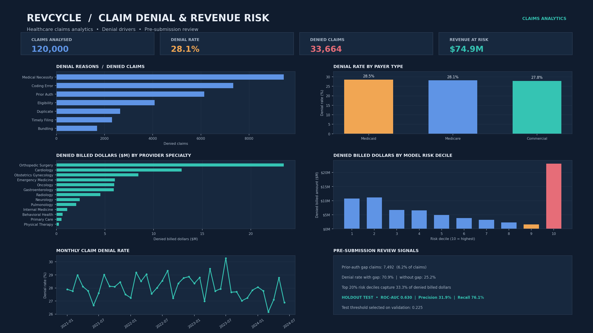

# RevCycle – Healthcare Claim Denial Prediction & Revenue-at-Risk Analytics

This project uses the supplied DenialIQ claim files to examine denial patterns and build a baseline model for pre-submission review. The workflow uses Python, MySQL 8.0+ and Power BI.

## Project results

| Measure | Calculated result |
|---|---:|
| Claims analysed | 120,000 |
| Denied claims | 33,664 |
| Overall denial rate | 28.05% |
| Train / validation / test rows | 84,051 / 18,018 / 17,931 |
| Leakage-audited test ROC-AUC | 0.6302 |
| Test precision (validation-selected threshold) | 31.9% |
| Test recall (validation-selected threshold) | 76.1% |
| Validation-selected threshold | 0.225 |
| Top two risk deciles' share of denied billed dollars | 33.31% |
| Total modelled revenue at risk | $74,914,762.88 |

The supplied split is used as provided. The counts are 84,051 training, 18,018 validation and 17,931 held-out test records. Precision and recall are reported at a threshold selected on the validation split by F1; the test split is not used to choose the threshold.

## Dashboard preview

The top KPI banner leads with modelled revenue at risk. The dashboard also shows denial reasons, payer denial rates, denied billed dollars by provider specialty, denied billed dollars across all ten model-risk deciles, and the monthly trend. Model validation metrics are in the lower-right review box.

## Important model audit: removing target leakage

The earlier model included `documentation_completeness`. In the supplied file, this field is unusually close to a label: on the held-out test split, using this field alone in the expected direction gives a ROC-AUC diagnostic of 0.9776. Denied records have documentation scores in a substantially lower band than paid records. That pattern is a warning that the field may have been generated from, or after, the outcome rather than independently measured before submission.

To avoid presenting this as a credible pre-submission predictor, `documentation_completeness` is excluded from model training. The model also excludes `outcome`, denial reason/category codes, and appeal/recovery fields. This produces a much lower but more defensible test ROC-AUC of 0.6302. The uploaded data does not support the previously suggested 0.76–0.82 range once the suspicious documentation field is removed; that range is not forced into the report.

## Analysis steps

1. Join `claims_main.csv` to the supplied train/validation/test split by `claim_id`, and join payer/CPT reference rules using `payer_type` and `cpt_code`.
2. Define the target as `outcome == "denied"`. `paid`, `partial_pay` and `pending` are not labelled as denials in this binary baseline.
3. Prepare eight pre-submission inputs: prior-authorisation gap, prior-authorisation obtained status, log claim amount, payer group, provider specialty, CPT risk tier from payer-rule history, modifier presence and authorisation lead time.
4. Fit an unweighted logistic regression for probability estimation. Numeric fields are median-imputed and standardised; payer group and provider specialty are one-hot encoded.
5. Use five-fold out-of-fold predictions for training rows when ranking the full portfolio. Validation and test probabilities come from a model trained only on the training split. This avoids ranking training claims with in-sample predictions.
6. Select a classification threshold on validation only. Compute `revenue_at_risk_usd = predicted_denial_prob × claim_amount_usd` and assign ten model-risk deciles.
7. Export the scored flat file for Power BI and the four normalised MySQL CSVs.

## Model notes

The estimator is `LogisticRegression(solver="lbfgs", max_iter=200, class_weight=None)`. Class weighting is not used for the PD estimate because it shifts the class prior and can inflate probability-based revenue-at-risk totals. The logistic regression is a baseline, not a production denial adjudication system. The top-decile capture is descriptive on this generated scenario dataset and should not be interpreted as causal impact.

The source has no date-of-service field, so a true submission-lag variable cannot be calculated. The model uses `auth_lead_time_days` from payer/CPT reference rules instead. The files also do not contain actual paid amounts, individual provider NPIs, facility types or regions; those remain blank or are represented at specialty level in the star-schema export rather than being guessed. `standard_charge_usd` in the procedure dimension is the median observed claim amount by CPT code, a descriptive proxy rather than an official fee schedule.

## MySQL star schema

- `dim_payers.csv`: source payer products grouped into Commercial, Medicare and Medicaid, with filing limits and prior-authorisation rule summaries.
- `dim_providers.csv`: specialty-level dimension for the 13 specialties in the source. The source does not provide individual provider IDs or NPIs.
- `dim_procedures.csv`: CPT-level dimension with diagnosis descriptor, authorisation requirement and median claim-amount proxy.
- `fact_claims.csv`: one row per claim with outcome, denial label, leakage-audited PD, modelled revenue at risk and risk decile.

Run `RevCycle_Denial_Analysis.sql` in MySQL 8.0 or later. Import the dimension CSVs before `fact_claims.csv` so the foreign keys can be satisfied. The script includes joins, CTEs and window functions to compare payer type, specialty, CPT and prior-authorisation gaps.

## Power BI

Import `data/revcycle_powerbi_ready.csv` and rename the table to `RevCycle`. Add the measures in `PowerBI_DAX_Measures.dax`. Useful slicers are payer type, payer name, provider specialty, place of service, CPT code, prior-auth status, denial category and split set. The PNG is a static dashboard preview, not a `.pbix` report file.

## Folder contents

- `RevCycle_Claim_Denial_Analytics.ipynb` – executed notebook with data joins, leakage audit, model evaluation and risk scoring.
- `RevCycle_Denial_Analysis.sql` – MySQL 8.0+ DDL and analytical queries.
- `PowerBI_DAX_Measures.dax` – DAX measures.
- `images/revcycle_dashboard.png` – refreshed dashboard preview.
- `data/revcycle_powerbi_ready.csv` – flat Power BI import with recalculated scores.
- `data/dim_payers.csv`, `data/dim_providers.csv`, `data/dim_procedures.csv`, `data/fact_claims.csv` – normalised CSV imports.
- `source_data/` – copies of the supplied input files.

## Reproduce the analysis

Install `pandas`, `numpy`, `scikit-learn`, `matplotlib`, `nbformat`, `nbclient`, `sqlalchemy` and `pymysql`. Open the notebook from the extracted project folder and run cells from top to bottom. For MySQL, set the `REVCYCLE_DB_PASSWORD` environment variable locally. The notebook does not store a database password in a file that may be shared.

## Data use and limitations

The source `claims_main.csv` marks every row as `synthetic_flag=True`. These generated scenario records are not actual patient billing records. Use the project to practise the analytics workflow, not to make claims about real provider or payer populations. The model results reflect the structure of this supplied scenario file; they are not evidence of real-world predictive performance.
